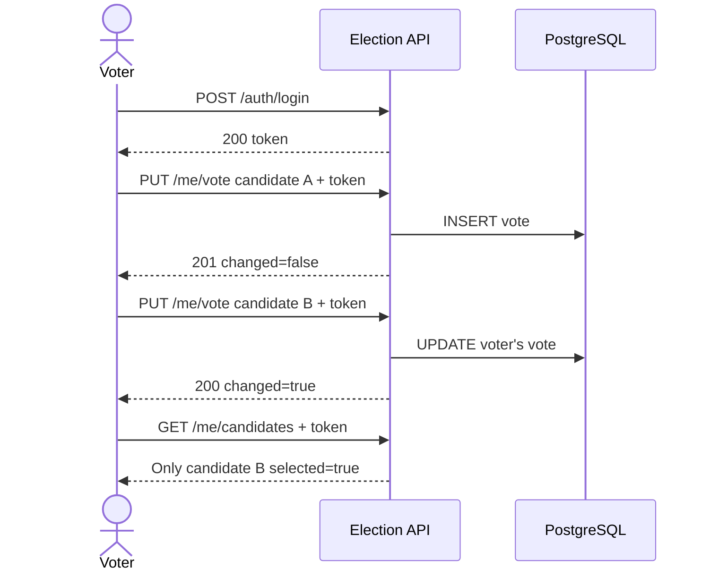
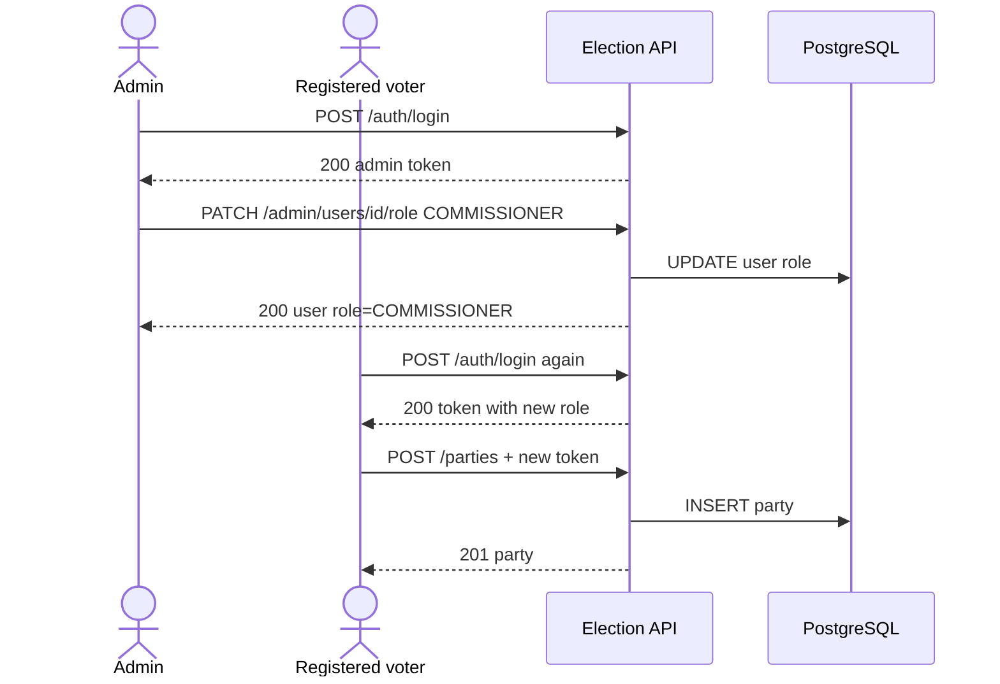

# E2E Exercise Test — ผลงาน workshop

ทำตาม `labs/e2e-exercise-test/README.md` จาก branch `jest/lab/e2e-exercise-test` ที่ commit `031ffc2` โดยไม่ได้อ่านหรือคัดลอกจาก solution branches เริ่มงานบน branch `step/e2e-exercise-test` ที่มีเนื้อหาตรงกับ instructor lab

## วิธีรัน

ใช้ Node.js 24+, Docker Desktop และ Docker Compose; จาก root ของ repository:

```bash
cd e2e-exercise
npm ci
npm run test:cycle
npm run report
```

`test:cycle` ทำ Step 1 → 2 → 5 → 6 อัตโนมัติ: ล้าง environment เดิม, สร้าง PostgreSQL แบบ tmpfs, migrate ด้วย contexts `e2e,e2e-exercise`, build/start SUT, รัน Playwright และ cleanup ด้วย EXIT trap แม้ tests ล้มเหลว จึงใช้กับ CI ได้หลัง `npm ci` ต้องไม่มีงานอื่นใช้ Compose project `election` และ ports 3000/5434 พร้อมกัน

API tests ใช้ `request` fixture จึงไม่ต้องติดตั้ง browser; `npm test` รันเฉพาะ tests กับ API ที่เปิดอยู่ ส่วน `BASE_URL` เปลี่ยนปลายทาง HTTP ได้ แต่ cycle script นี้เตรียม Docker ในเครื่องตาม lab เสมอ

## Step 1–6 และ exercise เพิ่มเติม

1. **Dependencies/data:** start `db-e2e` และใช้ Liquibase; ตรวจ history พบ 12 changesets รวม `902-*` ทั้งสองรายการ ตรวจ SQL พบ CM-2 หมายเลข 1 อนันต์/พรรคดอยสุเทพ และหมายเลข 2 มาลี/พรรคแม่ปิง
2. **SUT:** build image ของ Express TypeScript API และรอ healthcheck จริง ไม่ใช้เวลารอแบบเดา ได้ HTTP 200 `{"status":"ok"}`
3. **Playwright:** สร้าง project แยก มี lockfile, list/HTML reporters และ health smoke test; ทดลองหยุด app แล้วได้ ECONNREFUSED และเริ่มกลับจนผ่าน
4. **Journey S1:** ใช้ generator สร้างเลข checksum ถูกต้องหนึ่งครั้ง แล้ว fix `9534815455308` ใน test; register → ตรวจ 201 และข้อมูล VOTER แบบทั้ง object/ไม่มี passwordHash → login → ใช้ Bearer token อ่านผู้สมัคร → ตรวจทั้ง array ว่ามีสองคน เรียงถูก และ selected=false ทุกคน ใช้ `test.step()` ครบห้าขั้นตาม lab
5. **Run/report:** รันจริงและทดลอง failure cases ตามตารางด้านล่าง; reset และรันครบวงจรซ้ำเพื่อพิสูจน์ repeatability
6. **Cleanup:** `docker compose --profile e2e down`; ตรวจ `docker compose ps -a` หลังรอบสุดท้าย

Exercise เพิ่มเติมครบ 4 ข้อ:

- **S3:** voter `9747637058449` อยู่ CM-3; กกต. เตรียมพรรคและผู้สมัครสองคนผ่าน HTTP เป็นข้อมูลของ test นี้เอง ตรวจ ballot ก่อนลงคะแนน, ตรวจ 201/changed=false/votedAt และอ่านใหม่ให้ selected=true เฉพาะหมายเลข 1
- **S7:** request ที่ไม่มี token ได้ 401 และ body `{"error":"authentication required"}` ตรงทั้ง object
- **Helper class:** `support/ElectionApi.ts` รวม register/login; register คืน response เพื่อให้ S1 ตรวจ contract ใน step ของตัวเอง ส่วน login ตรวจ status/token ทันที ต่างจาก `app/e2e/support/electionApi.ts` ที่มี helper หลาย endpoint และสร้าง nationalId ระหว่างรัน ชุดนี้ใช้ข้อมูล fix ตามข้อกำหนด lab และไม่ import implementation/helper ของ app
- **Automation:** `tools/run-cycle.sh` รวม setup, run และ teardown พร้อมส่งต่อ arguments เช่น `npm run test:cycle -- voter-sees-candidates`

S1 และ S3 แยก voter/เขต/ผู้สมัครกัน จึงรันพร้อมกันได้ อ่าน seeded commissioner ร่วมกันเฉพาะเพื่อ authentication โดยไม่เปลี่ยน role ผู้สมัคร CM-2 ใช้ read-only ส่วน S3 สร้างข้อมูลใน CM-3 ทุก fresh cycle

## ผลทดสอบจริง — 17 ตุลาคม 2026 (Asia/Bangkok)

เครื่องที่ใช้: Node.js 24.11.1, npm 11.6.2, Docker Engine 29.1.2, Compose 2.40.3, Playwright 1.64.1; PostgreSQL 17 และ Liquibase 5.0.4 ใน Docker

| การทดลอง | ผลจริง | ความหมาย |
| --- | --- | --- |
| Smoke ครั้งแรก | 1 passed (368ms) | runner ติดต่อ API ได้ |
| หยุด app แล้ว smoke | 1 failed, ECONNREFUSED | จับ infrastructure failure ได้ |
| คืน app แล้ว suite | 4 passed (1.0s) | S1/S3/S7 และ health ผ่าน |
| S1 ซ้ำโดยไม่ reset | 1 failed; expected 201, received 409 | national id already registered |
| Fresh full cycle 1 | 4 passed (1.1s) | reset + seed + build + tests + teardown ผ่าน |
| Fresh full cycle 2 | 4 passed (832ms) | พิสูจน์ repeatability ของทั้งวงจร |
| Final clean cycle | 4 passed (961ms) | คืนค่าทั้งหมดแล้ว; teardown สำเร็จ |
| Latest verified local execution: `npm run test:cycle` | **4 passed (937ms)** | ผู้ใช้ยืนยันผลรันล่าสุด: Liquibase รัน 12 changesets สำเร็จ และ cleanup Docker containers/network สำเร็จ |
| เปลี่ยน voter เป็น CM-1 หลัง reset | 1 failed ที่ voter sees the CM-2 candidates; ได้ [] | เขตไม่ตรงข้อมูลที่คาด |
| Reset แล้ว migrate เฉพาะ e2e | 1 failed ที่ voter sees the CM-2 candidates; ได้ [] | ไม่มี exercise seed |
| Password เป็น 1234 หลัง reset | 1 failed; expected 201, received 400 | password must be at least 8 characters |

คืนค่า test source หลังทุกการทดลอง ไม่เปลี่ยน expected ให้ยอมรับข้อมูลผิด เก็บ raw logs ใน `experiment-results/` (ไม่ commit); HTML report อยู่ `playwright-report/` และเปิดด้วย `npm run report` หลังรอบสุดท้าย

ข้อผิดพลาดระหว่างดำเนินงาน: ตั้ง npm scripts ครั้งแรกใช้ `--json` กับค่าที่ไม่ใช่ JSON และอีกครั้งอยู่ผิด directory จึงตั้งค่าไม่สำเร็จ แก้โดยระบุ directory `e2e-exercise/` และแยก boolean option; ไม่มีการเปลี่ยน package ของ app นอกจากนี้ Compose รุ่นนี้ไม่รับ `start --wait` จึงใช้ `up -d --wait app` ในการ recovery การลอง suite ก่อน recovery เสร็จทำให้ 4 tests ได้ ECONNREFUSED; หลังคืน app ครบผ่าน 4/4 ไม่ใช่ bug ของ SUT

## แนวคิดสำคัญและคำตอบปิด lab

**1. ถ้า fail ที่ 4.2.5 รู้ได้อย่างไรว่า bug อยู่ route, service, repository หรือ test data?**

E2E บอกได้ว่าพฤติกรรมจากภายนอกผิด แต่ชี้ layer ต้นเหตุอย่างแน่นอนไม่ได้ เริ่มดูว่า register/login/HTTP status ผ่านหรือไม่ อ่าน response body และ `docker compose logs app` ตรวจว่า token เป็นของ voter/เขตที่ตั้งใจ จากนั้นตรวจ Liquibase history/context และ SELECT ผู้สมัครเทียบ seed เพื่อแยกปัญหา environment/data หากข้อมูลถูกต้องให้ใช้ component/integration tests ของ route และ repository (กับ PostgreSQL จริง) รวมถึง unit tests ของ service เพื่อจำกัดสาเหตุ เช่น route ส่ง district ผิด, service กรองผิด หรือ SQL join/order ผิด อย่าแก้ expected ให้ตรงผลผิดเพียงเพื่อให้เขียว ตัวอย่าง lab ที่ย้าย voter ไป CM-1 หรือไม่ inject 902 ได้ `[]` ซึ่งเกิดจากข้อมูล/การจัด environment ไม่ใช่หลักฐานว่า route เสีย

**2. ทำไม E2E ควรน้อยกว่า unit test และจับอะไรที่การทดสอบเล็ก ๆ ไม่ครอบคลุม?**

E2E ต้อง build/start หลายส่วน ใช้เวลาและทรัพยากรสูงกว่า และเมื่อ fail ระบุต้นเหตุยากกว่า เลือก critical business journeys ส่วน validation และกรณีย่อยจำนวนมากให้ unit/component tests ตรวจ E2E ช่วยพบความผิดพลาดเมื่อระบบจริงทำงานร่วมกัน เช่น route wiring, middleware/JWT, JSON serialization ที่เผลอคืน passwordHash, migration/schema/query ไม่เข้ากัน, DATABASE_URL/Docker network และไฟล์ build/runtime ใน image ที่ขาด แม้แต่ละหน่วยผ่านด้วย mock ก็ยังผิดเมื่อประกอบจริงได้ การทดสอบระดับอื่นอาจตรวจบางเรื่องเหล่านี้ได้ด้วย; จุดเด่น E2E คือพิสูจน์เส้นทางทั้งระบบใน environment ใกล้ deploy ชุดนี้เป็น API E2E จึงไม่ได้ยืนยัน UI, browser หรือโครงสร้าง production ทั้งหมด

**3. Inject ผ่าน Liquibase SQL กับ API ต่างกันอย่างไร และแบบไหนเสี่ยงเมื่อ schema เปลี่ยน?**

SQL เร็ว, version พร้อม schema และเตรียม reference/admin data ที่ API สร้างไม่ได้ แต่ผูกกับชื่อตาราง/คอลัมน์/FK โดยตรง และข้าม business rules จึงเสี่ยงมากกว่าเมื่อ schema เปลี่ยน เช่น NOT NULL ใหม่ทำให้ seed รันไม่ได้ หรือข้อมูลไม่ตรงกฎ API ใช้ contract และ business rules จริง จึงทนต่อการเปลี่ยน schema ภายในมากกว่า แต่ช้ากว่า ต้อง login/จัดลำดับ request และอาจ fail เพราะ endpoint เตรียมข้อมูลมี bug เอง หาก API contract เปลี่ยน helper ก็ต้องเปลี่ยนตาม Lab ใช้ SQL เตรียม S1 ส่วน S3 ใช้ API จึงเห็น tradeoff ทั้งสองแบบ

**AAA, deterministic และ test isolation:** Arrange คือข้อมูล voter/seed, Act คือ HTTP request, Assert คือตรวจ status และ body ข้อมูล fix ทำให้ตามรอย failure ได้ง่าย แต่ไม่ได้ทำให้ database กลับเป็นของใหม่เอง ต้อง reset ทั้งวงจร และแต่ละ test ต้องเป็นเจ้าของข้อมูลที่แก้ไข `expect.any(Number)` ยอมรับ id ที่ DB สร้าง โดยยังตรวจ shape/ค่าทางธุรกิจอย่างเคร่งครัด ไม่ยึด auto-increment id ที่คาดเดา

## Sequence diagrams สำหรับ S4 และ S5

เป็นแบบฝึกหัดออกแบบ flow เพิ่มเติม ยังไม่ได้เพิ่ม automated tests สำหรับ S4/S5 เพราะ exercise ที่กำหนดให้เขียนคือ S1/S3/S7





ต้อง login ใหม่หลังเปลี่ยน role เพราะ token เดิมยังบรรจุ role เดิมอยู่

## Repository ปลายทาง

Workshop ถูก push ไปยัง GitHub repository ของผู้ใช้สำเร็จแล้ว:

- Repository: https://github.com/Nichafah/e2e-workshop
- Branch: `step/e2e-exercise-test`
- `origin`: `https://github.com/Nichafah/e2e-workshop.git`
- `upstream`: repository ผู้สอน ใช้ fetch; push URL เป็น `DISABLED`
- ตั้ง `remote.pushDefault=origin`, `push.default=current` และ local branch ติดตาม `origin/step/e2e-exercise-test`

Push ด้วย `git push origin step/e2e-exercise-test` และตรวจว่า local/remote ตรงกันด้วย `git fetch origin` ตามด้วย `git rev-list --left-right --count HEAD...origin/step/e2e-exercise-test` ซึ่งควรได้ `0 0` ไม่ใช้คำสั่ง force push

รอบสุดท้าย HTML report server ตอบ HTTP 200; ตรวจ embedded report data ว่ามีผลผ่านครบและ journey steps; `docker compose ps -a` ไม่มี containers เหลือ ตรวจ shell syntax และ `git diff --check` ผ่าน
